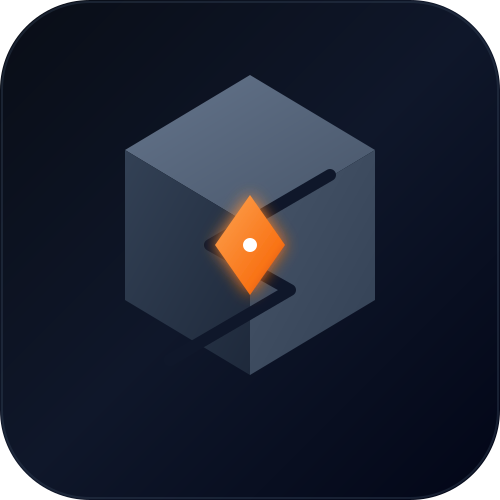

<p align="center">
  
</p>

<h1 align="center">Silex</h1>

<p align="center">
  <strong>Native Rust-powered, framework-independent UI component engine and design system.</strong>
</p>

<p align="center">
  <a href="#features">Features</a> •
  <a href="#quick-start">Quick Start</a> •
  <a href="#architecture">Architecture</a> •
  <a href="#cli">CLI</a> •
  <a href="#theme">Theme</a>
</p>

---

## Features

- **Pure Rust Engine**: High-performance state machines, WCAG contrast calculators, and token parsers with zero JavaScript runtime overhead.
- **Flint & Obsidian Design Philosophy**: Modern, high-contrast, tactile UI components with crisp geometric borders and ember highlights.
- **Framework-Independent & WASM Ready**: Built with `wasm-bindgen` and native C-ABI compatibility for cross-platform and web consumption.
- **Native Rust CLI**: Instant component scaffolding and configuration with the `silex` command-line utility.

---

## Workspace Structure

```text
silex/
├── Cargo.toml               # Top-level Cargo Workspace
├── assets/
│   ├── logo.svg             # Silex Flint & Ember SVG Logo
│   └── icon.svg             # Silex Favicon / App Icon
├── crates/
│   ├── silex-core/          # Core component logic, state & renderers
│   │   ├── Cargo.toml
│   │   └── src/
│   │       ├── components/  # Button, Dialog, Card, Alert, Switch, Badge...
│   │       ├── theme.rs     # Silex design tokens and theme palettes
│   │       └── lib.rs
│   └── silex-cli/           # Native command-line tool (silex)
│       ├── Cargo.toml
│       └── src/
│           └── main.rs
└── apps/
    └── docs/                # React 19 + TypeScript + Tailwind documentation portal
```

---

## Quick Start

### 1. Build and Test the Workspace

```bash
# Build all crates
cargo build --workspace

# Run unit tests
cargo test --workspace

# Generate Rustdoc documentation
cargo doc --workspace --no-deps
```

### 3. Launching the React + TypeScript Documentation Portal

```bash
cd apps/docs
npm run dev
# Running on http://localhost:5173
```

```bash
# Display help and usage
cargo run -p silex-cli -- --help

# List available registry components
cargo run -p silex-cli -- list

# Live preview server in your browser (default port 3000)
cargo run -p silex-cli -- preview

# Live preview for a specific component on custom port
cargo run -p silex-cli -- preview --component button --port 8080

# Export component preview to a static HTML file
cargo run -p silex-cli -- preview --export preview.html

# Initialize a new project with Silex
cargo run -p silex-cli -- init

# Add a component
cargo run -p silex-cli -- add button
cargo run -p silex-cli -- add dialog
```

---

## Component Suite (`crates/silex-core`)

All components in `silex-core` provide accessible state management, class generation, and HTML rendering:

| Component | State Machine / Logic | Methods |
|---|---|---|
| **`ButtonProps`** | Variant, Size, Loading & Disabled states | `compute_classes()`, `render_html()` |
| **`DialogState`** | 4-Stage Lifecycle (`Opening`, `Open`, `Closing`, `Closed`) | `open()`, `close()`, `toggle()` |
| **`CardProps`** | Surface variants & interactive hover animations | `compute_classes()` |
| **`AlertProps`** | Contextual notifications & destructive styling | `compute_classes()` |
| **`SwitchState`** | Controlled / uncontrolled toggle state | `toggle()`, `compute_classes()` |
| **`BadgeProps`** | Status indicators and removable chip logic | `compute_classes()` |
| **`AccordionState`** | Single / multiple disclosure state machine | `toggle()`, `is_open()` |

---

## Color & Contrast Compliance

Silex includes native WCAG contrast compliance algorithms:

```rust
use silex_core::{calculate_luminance, calculate_contrast_ratio};

let white_lum = calculate_luminance(255.0, 255.0, 255.0);
let slate_lum = calculate_luminance(15.0, 23.0, 42.0);
let ratio = calculate_contrast_ratio(white_lum, slate_lum);
assert!(ratio >= 4.5); // Conforms to WCAG AAA
```

---

## Silex Theme Specification

| Token | Name | Hex Code | Purpose |
|---|---|---|---|
| **Obsidian** | Deep Background | `#0f172a` | Primary canvas & backdrop |
| **Flint** | Surface Slate | `#1e293b` | Elevated cards & modals |
| **Titanium** | Foreground | `#f8fafc` | Crisp typography & icons |
| **Ember** | Accent Spark | `#f97316` | Active actions & indicators |
| **Border** | Subtle Edge | `#334155` | Geometric component borders |

---

## License

MIT © Silex Contributors
